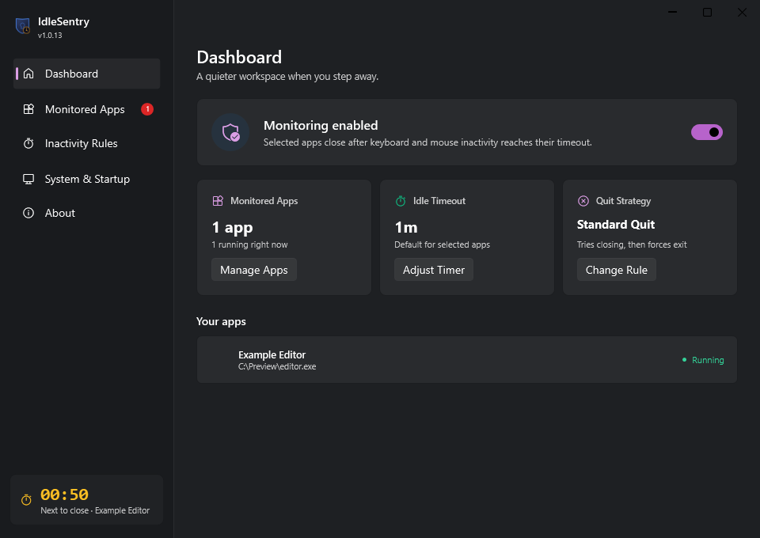

<p align="center">
  <a href="https://github.com/synthwave541/IdleSentryForWindows/releases/latest"></a>
  
</p>

<h1 align="center">IdleSentry for Windows</h1>

<p align="center">Close the apps you choose when you step away.</p>

<p align="center">
  <a href="https://github.com/synthwave541/IdleSentryForWindows/actions/workflows/build.yml"></a>
  
  
  <a href="LICENSE"></a>
</p>

<p align="center">
  <a href="https://github.com/synthwave541/IdleSentryForWindows/releases/latest">Download latest</a> ·
  <a href="https://github.com/synthwave541/IdleSentry">macOS version</a> ·
  <a href="https://zennoris.com">Website</a> ·
  <a href="https://github.com/synthwave541/IdleSentryForWindows/issues">Report an issue</a>
</p>

IdleSentry is a Windows tray utility that closes selected applications after a
period of keyboard and mouse inactivity. Choose your apps, set a timeout, and
leave IdleSentry running in the background.

This repository contains the C#/WPF Windows counterpart of
[IdleSentry for macOS](https://github.com/synthwave541/IdleSentry), with builds for
Intel/AMD x64 and Windows on ARM.



*Sample dashboard with illustrative app data. Accent colors follow Windows personalization.*

## What it does

- **Choose apps by name.** Search installed and running apps, see their icons, and add several at once. Manual executable browsing is available when needed.
- **Set an inactivity timeout.** Choose from 10 seconds to 60 minutes. Keyboard or mouse activity resets the countdown.
- **See what closes next.** A single amber countdown stays in the sidebar across all pages; app rows show their running status.
- **Choose how apps close.** Standard Quit requests a normal close before forcing remaining processes to exit. Force Quit closes them immediately.
- **Keep it in the tray.** Closing the window keeps monitoring active. Pause monitoring or quit IdleSentry from its tray menu.
- **Match your desktop.** Fluent styling, your Windows accent color, and selection motion that respects the Windows animation preference.
- **Keep settings local.** No accounts, telemetry, or cloud service. Preferences are stored on your PC.

**Closing an app can lose unsaved work with either quit strategy.** Standard Quit
does not guarantee that an app saves its data. IdleSentry complements your screen
lock; it does not lock Windows or hide applications that you have not selected.

## Download and install

Open the [latest release](https://github.com/synthwave541/IdleSentryForWindows/releases/latest) and
choose the package for your PC:

| Package | Use it on |
| --- | --- |
| `win-x64-Setup.exe` | Intel and AMD 64-bit Windows PCs |
| `win-arm64-Setup.exe` | Windows on ARM devices, including Snapdragon PCs |
| `win-…-Portable.zip` | The same architecture, without running an installer |

Requires **Windows 10 version 2004 (build 19041) or later**, or Windows 11.
Mica effects are available on Windows 11. There is no 32-bit x86 build.

The installer runs for the current user, adds a Start menu shortcut, and provides
an uninstaller. A desktop shortcut is optional. Portable packages can be extracted
to a folder and launched with `IdleSentry.exe`. Neither package requires a
separate .NET installation.

The current binaries are unsigned and may display Windows publisher or reputation
warnings. Download only from this repository's releases. Each release includes
`SHA256SUMS.txt` for file-integrity checks.

## Get started

1. Open IdleSentry and select **Add Application**.
2. Search for an app, tick it, and select **Add apps**.
3. Open **Inactivity Rules** and choose a timeout and quit strategy.
4. Confirm that monitoring is enabled. You can then close the window to keep IdleSentry in the tray.

For an initial test, use an app with no unsaved work, set the timeout to 10 seconds,
and leave the keyboard and mouse untouched for about 15–20 seconds. Restore your
preferred timeout after the test.

If an app is missing from the chooser, open it and select **Refresh**. Some
Microsoft Store apps, elevated apps, and unusual launchers may not appear.
**Browse…** provides a manual fallback. Discovery does not guarantee support for
every Windows application.

Settings live in `%LOCALAPPDATA%\IdleSentry\settings.json`. Portable mode uses the
same settings location; it does not store preferences beside the executable.
Quit the tray app before upgrading or uninstalling. Uninstalling retains your
preferences and removes a login-startup entry only when it points to that
installed copy.

## Build from source

Install the [.NET 8 SDK](https://dotnet.microsoft.com/download/dotnet/8.0) on Windows,
then run these commands in PowerShell:

```powershell
git clone https://github.com/synthwave541/IdleSentryForWindows.git
cd IdleSentryForWindows
& './IdleSentry for Windows/build.ps1' -Arch all
```

Self-contained executables are written to
`IdleSentry for Windows/publish/win-x64/` and `publish/win-arm64/`.
Use `-Arch x64` or `-Arch arm64` to build one architecture.

Run the development checks from the repository root:

```powershell
dotnet run --project './IdleSentry.ChooserTests/IdleSentry.ChooserTests.csproj' -c Release
```

To build the interactive installers, install
[Inno Setup 6.3 or later](https://jrsoftware.org/isdl.php), then run:

```powershell
& './IdleSentry for Windows/build-installer.ps1' -Arch all
```

Setup executables, portable ZIPs, and checksums are written to
`IdleSentry for Windows/dist/`. The scripts compile the installer; end users run
the resulting `Setup.exe`.

## Repository layout

| Path | Contents |
| --- | --- |
| `IdleSentry for Windows/` | Application source, assets, dependency notices, and build scripts |
| `IdleSentry for Windows/installer/` | Inno Setup installer source |
| `IdleSentry.ChooserTests/` | App discovery, navigation, presentation, and countdown checks |
| `.github/workflows/` | Windows build and verification workflow |
| `docs/images/` | Documentation images using sample data |

Generated binaries and local files are ignored by Git. The tests are development
tools and are not included in installed or portable app packages.

See [developer notes](IdleSentry%20for%20Windows/README.md),
[release history](CHANGELOG.md),
[publishing instructions](IdleSentry%20for%20Windows/PUBLISHING.md), and
[contribution guidelines](CONTRIBUTING.md) for more details.

## Credits and license

Created by **Anush Vishwakarma / Zennoris**. Visit [zennoris.com](https://zennoris.com).
The original macOS implementation is maintained in
[synthwave541/IdleSentry](https://github.com/synthwave541/IdleSentry).

Source code is distributed under the [Apache License 2.0](LICENSE). Dependency
licenses are included in
[THIRD-PARTY-NOTICES.txt](IdleSentry%20for%20Windows/THIRD-PARTY-NOTICES.txt).
The license does not grant trademark rights to the IdleSentry name or branding.
